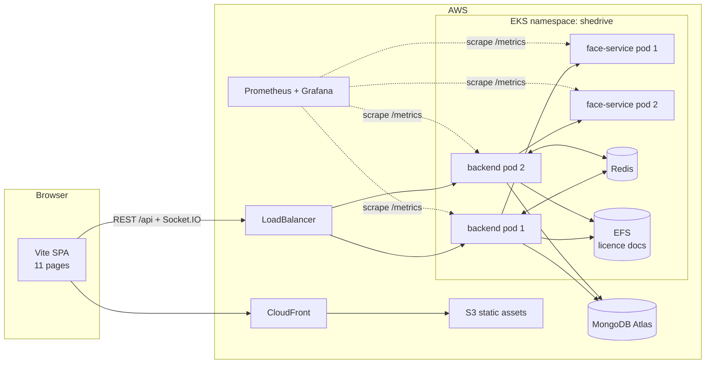
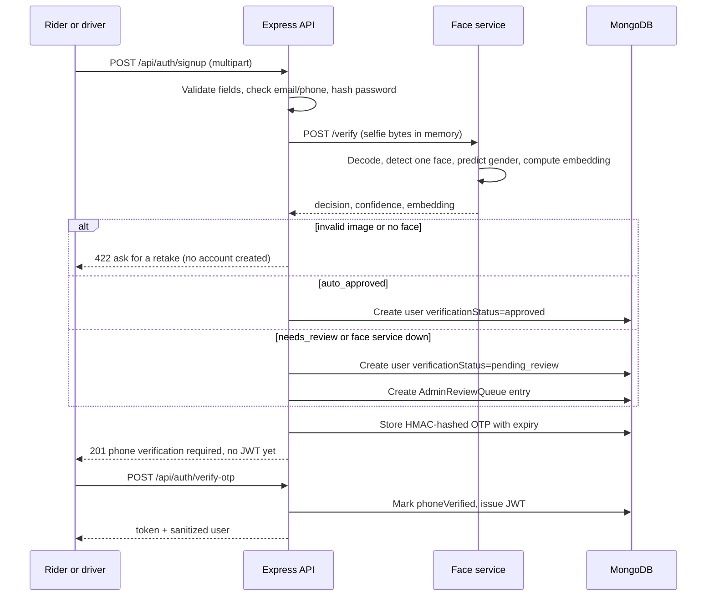
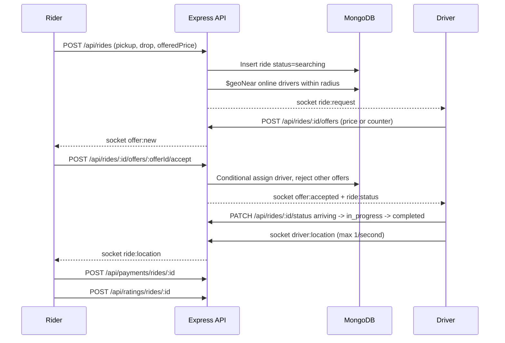
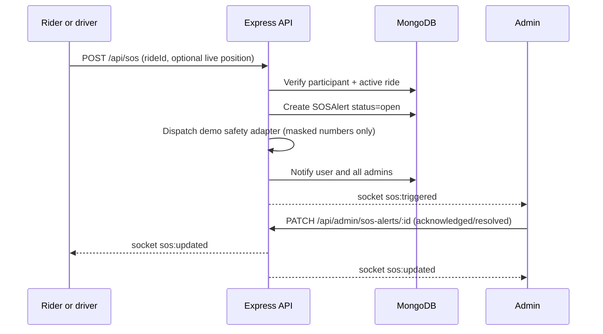

# SheDrive architecture

SheDrive is a women-only ride-hailing platform with selfie-based gender verification and
inDrive-style fare negotiation. This document describes the runtime components, the main
request flows, the data stores, and the trade-offs behind the implementation.

## 1. Goals and non-goals

**Goals**

- A complete demo that runs locally with one command and deploys to AWS EKS.
- A face check at signup that never auto-approves someone the model is unsure about.
- A fare negotiation flow: rider offers a price, drivers accept or counter-offer.
- Realtime offers, live tracking, notifications, SOS, payments and ratings.
- Privacy by design: raw selfies stay in memory and are never stored.

**Non-goals**

- Real payments. Cash and wallet payments are recorded locally; no gateway is integrated.
- Real emergency dispatch. The SOS adapter logs masked numbers and sends nothing.
- A trained gender classifier. SheDrive uses the existing open-source DeepFace models as a
  first-pass filter only.
- Guaranteed gender accuracy. The model is probabilistic; human review is the fallback.

## 2. Runtime components

| Component | Technology | Responsibility | Scaling model |
|---|---|---|---|
| Frontend | Vite, HTML/CSS/ES modules, Tailwind, Three.js, Leaflet, Socket.IO client | Eleven pages, 3D visuals, REST calls, realtime updates | Static files on S3 + CloudFront |
| Backend API | Node.js 20, Express, Socket.IO, Mongoose | Auth, rides, offers, payments, ratings, SOS, admin, realtime rooms | Stateless, 2+ replicas behind a load balancer |
| Face service | Python, FastAPI, DeepFace, OpenCV | Selfie validation, gender prediction, embedding, decision | Internal ClusterIP, 2 replicas, CPU-bound |
| Database | MongoDB (container locally, Atlas in production) | Users, rides, offers, payments, ratings, SOS, notifications | Atlas managed cluster |
| Realtime fan-out | Redis pub/sub (optional) | Syncs Socket.IO rooms across backend replicas | 1 Redis service |
| Licence documents | Docker volume locally, Amazon EFS in production | Private driver licence PDFs/images | ReadWriteMany |
| Registry | Amazon ECR | Backend and face-service images | Managed |
| Monitoring | Prometheus, Grafana, Alertmanager | Metrics, dashboards, alerts | Helm chart in `monitoring` namespace |

## 3. System context



In development, `docker compose up --build` replaces CloudFront/S3 with an nginx container,
EKS with local containers, Atlas with a local MongoDB container, and EFS with a Docker
volume. Vite's dev server proxies `/api` and `/socket.io` to the backend, so the browser
always uses one origin.

## 4. Backend structure

The backend follows a small layered pattern so each concern is easy to test:

```
routes/         URL paths, middleware, validation selection
validation/     Joi schemas for bodies and query strings
controllers/    request/response handling and business rules
services/       face client, fare maths, OTP, notifications, realtime, storage
repositories/   all Mongoose queries
models/         schemas and indexes
sockets/        authenticated Socket.IO handshake and events
middleware/     auth, roles, verification gate, uploads, rate limits, errors
utils/          serializers, error type, reference generator
```

Controllers never build raw Mongo queries; repositories do. Serializers turn database
documents into stable JSON shapes so the frontend does not depend on internal fields
(for example `passwordHash` and `faceEmbedding` are `select: false` and never serialized).

## 5. Signup and face verification flow



Decision rules (`face-service/app/verify.py`):

| Face service result | Backend action |
|---|---|
| `no_face`, multiple faces, invalid image | Reject signup with a friendly retake message |
| `auto_approved` (female and confidence >= threshold) | `verificationStatus = approved` |
| `needs_review` (low confidence or not female) | `verificationStatus = pending_review` + review queue |
| Face service unavailable or timeout | Fail safe: `pending_review` + review queue |
| Driver licence missing | 422 before any account is created |

`requireVerified` blocks booking, offers, payments, ratings, SOS and online status until
`verificationStatus === approved`. Browsing and profile edits remain available while an
account is under review. The UI never says "rejected" during signup; it says "under review".

## 6. Ride negotiation and tracking flow



### Ride state machine

```
searching -> accepted -> arriving -> in_progress -> completed
    |            |           |
    +------------+-----------+--> cancelled
```

- Only the assigned driver can move a ride forward, and only along this graph.
- A rider or driver can cancel while the ride is `searching`, `accepted` or `arriving`.
- Accepting an offer is a conditional Mongo update (`status: searching`, `driver: null`),
  so two riders or two offers cannot assign a driver twice.
- Completing a ride frees the driver's `activeRide`, enabling the next request.

### Offer state machine

```
pending -> accepted
pending -> rejected
pending -> expired   (TTL or rider accepted another offer)
pending -> counter-offer is a new pending offer with a different price
```

Offers expire after `RIDE_OFFER_TTL_SECONDS` (45 seconds by default). A driver can update
their offer by upserting a pending offer for the same ride.

### Fare model

`fareService.estimateFare` uses:

```
roadDistanceKm = haversine(pickup, drop) * FARE_ROAD_FACTOR   (minimum 0.1 km)
suggestedFare  = max(FARE_MINIMUM, round5((FARE_BASE + roadDistanceKm * FARE_PER_KM) * vehicleMultiplier))
durationMinutes = max(3, round(roadDistanceKm * 2.4 + 2))
```

Vehicle multipliers: Car `1.0`, Auto `0.72`, Bike `0.55`. The suggested fare is only a
hint; the rider sends their own integer offer between INR 20 and 10,000.

## 7. Realtime design

- The Socket.IO handshake requires a JWT in `auth.token` or the `Authorization` header.
- Every socket joins `user:<id>`; admins also join `admins`; ride participants join
  `ride:<id>` only after the server verifies they are the rider or assigned driver.
- Driver locations are validated, stored at most once per second, and rebroadcast as
  `ride:location` to the ride room and rider.
- When `REDIS_URL` is set, the Redis adapter fans events across backend replicas. Without
  it, the in-memory adapter is used for local development and tests.
- If Socket.IO is unavailable, the rider and driver pages fall back to polling the REST
  API so the core flow still works.

## 8. Payments, ratings and wallet

- Payments are recorded once per completed ride (`unique` on `ride`). Accepted methods are
  `cash` and `wallet`.
- Wallet payments deduct the rider balance and write a ledger entry in one flow; if the
  payment insert fails, the balance is restored.
- The demo wallet starts at INR 1,500 for the seeded rider; top-ups are 100 to 10,000.
- Both participants rate the other once per ride. Driver ratings recompute `ratingAvg` as
  the rounded average of all ratings received (5.0 when there are none).

## 9. Safety and SOS



- SOS requires an `accepted`, `arriving` or `in_progress` ride.
- Only one open alert per user at a time.
- If the browser cannot share a live position, the backend falls back to the pickup point.
- The emergency-contact adapter is explicitly a demo: it logs masked numbers and sends
  nothing externally. Admins still get an immediate in-app alert.

## 10. Data and storage

| Data | Store | Notes |
|---|---|---|
| Accounts, rides, offers, payments, ratings, SOS, notifications | MongoDB | Indexed for user history, active rides, 2D sphere pickup queries |
| Face embeddings | `User.faceEmbedding` | Numeric vectors only; selected out by default |
| Raw selfies | Never persisted | Decoded, analysed and discarded in face-service memory |
| OTP codes | `Otp` collection | HMAC-SHA256 hash, 10-minute TTL index, 5 attempts |
| Driver licence documents | `backend/storage/license-docs` / EFS | Private; served only through an admin-authenticated route |
| Wallet ledger | `WalletTransaction` | Immutable top-up and payment entries |

See [er-diagram.md](er-diagram.md) for the full schema and indexes.

## 11. Failure handling

| Failure | Behaviour |
|---|---|
| Face service down or timeout | Account becomes `pending_review`; never auto-approved |
| Face service returns 4xx | Signup fails with a retake message |
| MongoDB unreachable | `/health` stays live, `/health/ready` returns 503; load balancer stops routing |
| Redis unreachable | Backend logs the error; realtime degrades to per-pod delivery |
| Socket.IO disconnected | Pages poll REST endpoints |
| Duplicate offer acceptance | Conditional update returns 409; no double assignment |
| Wallet debit succeeds but payment insert fails | Balance is refunded |
| SOS dispatch adapter fails | Alert still stored, admins still notified |
| Face model preload fails | Service starts; `/health` exposes `model_loaded: false`; verification retries lazily |

## 12. Deployment topologies

### Local (Docker Compose)

```
frontend nginx :8080 -> backend :5000 -> mongo :27017
                          |-> face-service :8000
                          |-> seed one-shot job
                          |-> backend-storage volume
```

### Production (EKS)

- Two backend replicas with readiness (`/health/ready`) and liveness (`/health`) probes.
- Two internal face-service replicas; the image pre-downloads DeepFace weights at build
  time so pods start with models cached.
- Redis service for cross-pod rooms, EFS for shared licence documents, Atlas for MongoDB.
- Non-root containers, read-only root filesystems where possible, dropped capabilities,
  seccomp `RuntimeDefault`, and a NetworkPolicy limiting face-service and Redis ingress.
- Prometheus Operator ServiceMonitors scrape `/metrics` on both services.

Detailed AWS commands are in [aws-setup.md](aws-setup.md); manifests live in `k8s/`.

## 13. Observability

| Signal | Backend | Face service |
|---|---|---|
| Request count and latency | `shedrive_http_requests_total`, `shedrive_http_request_duration_seconds` | `http_requests_total`, `http_request_duration_seconds` via instrumentator |
| Realtime | `shedrive_active_socket_connections` | - |
| Supply and safety | `shedrive_online_drivers`, `shedrive_open_sos_alerts` | `shedrive_face_verifications_total{decision}` |
| Process | prom-client defaults with `shedrive_` prefix | Python process metrics |

Alerts cover scrape targets down, 5xx rate, p95 latency, open SOS alerts, and a spike in
`no_face` decisions. The Grafana dashboard is provisioned from
`k8s/monitoring/grafana-dashboard-configmap.yaml`.

## 14. Security boundaries

- Public internet: CloudFront static site and the backend load balancer only.
- Internal cluster: face-service is ClusterIP and only reachable from the backend.
- Trust boundary at the API: every request is authenticated, role-checked and validated;
  uploaded files are type/size limited; rate limits apply to auth and OTP routes.
- Filesystem: licence documents never enter the frontend bundle and are read through an
  admin-only handler that checks the filename pattern.
- Secrets: only environment variables and Kubernetes Secrets; `.env` files are ignored.

See [security-checklist.md](security-checklist.md) for the item-by-item verification.

## 15. Design trade-offs and future work

| Decision | Reason | Limitation / next step |
|---|---|---|
| DeepFace as a first-pass filter | No training data; open-source and explainable for a student project | Not accurate for all presentations; human review is mandatory |
| Manual review queue | Safety and inclusivity | Adds staff workload; could add ID matching |
| Minimal wallet ledger | Demonstrates payment flow without a gateway | Not PCI compliant; integrate a real PSP for production |
| Redis adapter optional | Keeps local setup simple | Without Redis, multi-replica rooms are not shared |
| Polling fallback | Core flow works on poor networks | Higher request volume than pure WebSockets |
| Licence docs on EFS | Shared by replicas without a database blob | EFS costs money; S3 with signed URLs is a cheaper alternative |
| Single MongoDB database | Simple local and Atlas setup | No sharding; large-scale deployments need capacity planning |
| Demo SOS dispatch | Keeps the project free and safe to run | Does not contact real emergency services |
