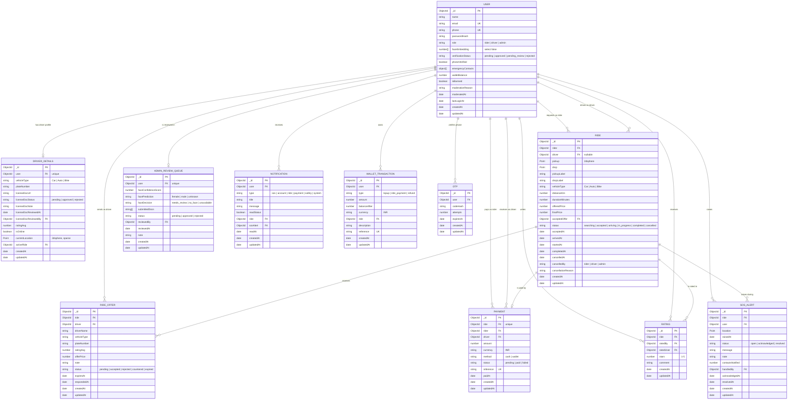

# SheDrive entity-relationship diagram

MongoDB is a document store, so the diagram below uses collection-level references
rather than foreign-key constraints. The application enforces the relationships and the
uniqueness rules shown here.

## 1. Entity-relationship diagram

## 2. Relationship rules

| Relationship | Cardinality | Enforced by |
|---|---|---|
| User -> DriverDetails | 1:0..1 | `unique` index on `DriverDetails.user` |
| User -> Ride (rider) | 1:N | `rider` required; one active ride checked in the ride service |
| User -> Ride (driver) | 1:N | `driver` nullable; `DriverDetails.activeRide` tracks the current trip |
| Ride -> RideOffer | 1:N | `ride` index; pending offers expire after the TTL |
| Ride -> Payment | 1:1 | `unique` index on `Payment.ride` |
| Ride -> Rating | 1:N (at most 2) | `unique` index on `{ ride, ratedBy }` |
| Ride/User -> SOSAlert | 1:N | One open alert per user enforced in the SOS controller |
| User -> AdminReviewQueue | 1:0..1 | `unique` index on `AdminReviewQueue.user` |
| User -> Notification | 1:N | Inbox list index `{ user, readStatus, createdAt }` |
| User -> WalletTransaction | 1:N | Ledger index `{ user, createdAt }` |
| User -> Otp | 1:N (one live code) | Previous codes are deleted before a new one is issued |

## 3. Collection notes and indexes

### User

- `email` is lower-cased and unique. `phone` is normalized to digits with an optional
  leading `+` and is unique.
- `passwordHash` and `faceEmbedding` use `select: false` and are also stripped by a
  `toJSON` transform. They are never returned by the API.
- `verificationStatus` is indexed for admin filters. Only `approved` unlocks rides.
- `walletBalance` is a denormalized running balance; `WalletTransaction` is the audit log.

### DriverDetails

- One document per driver. Created during driver signup with `licenseDocStatus = pending`.
- `currentLocation` is a GeoJSON Point with a sparse `2dsphere` index, used by `$geoNear`
  for nearby drivers and ride opportunities.
- `activeRide` prevents a driver from accepting a second trip.

### Ride

- `pickup` and `drop` are GeoJSON Points. `pickup` has a `2dsphere` index for nearby ride
  search; `drop` does not need one.
- Compound indexes `{ rider, status, createdAt }` and `{ driver, status, createdAt }`
  serve active-ride checks and history pages.
- `finalPrice` is copied from the accepted offer. If a ride completes without an accepted
  offer, it falls back to `offeredPrice`.

### RideOffer

- `expiresAt` is indexed and stale offers are marked `expired` before listings.
- Compound indexes serve "pending offers for a ride" and "this driver's pending offer".
- `driverName`, `vehicleType`, `plateNumber` and `ratingAvg` are snapshots so the rider sees
  the offer even if the driver profile changes later.

### Payment

- `ride` is unique, so a completed ride can be paid only once.
- `reference` is unique and human-readable (for example `PAY-...`).
- `status` defaults to `paid` because the demo records payments immediately.
- Wallet payments also write a `WalletTransaction` with the same reference.

### Rating

- One rating per rater per ride. The driver's `ratingAvg` is recomputed from all ratings
  received; it starts at 5.0 when there are no ratings.

### SOSAlert

- `status` index supports the admin safety queue. `{ user, status }` supports the
  one-open-alert check.
- `contactsNotified` records how many masked contacts the demo adapter "notified".

### AdminReviewQueue

- Created when the face result is `needs_review` (low confidence or not confidently
  female) or when the face service is unavailable. A `no_face` result returns a retake
  error at signup and does not create an account or review entry.
- `faceDecision` records why the account was queued (`needs_review` or `unavailable`).
  `reviewedBy` stores the admin.

### Notification and WalletTransaction

- Notifications are append-only with a read flag and optional ride/SOS references.
- Wallet transactions are append-only; `balanceAfter` lets the UI render a statement
  without replaying every entry.

### Otp

- `codeHash` is an HMAC-SHA256 of the code using `JWT_SECRET` as the key. The plain code is
  never stored.
- A MongoDB TTL index on `expiresAt` removes expired records automatically.

## 4. Privacy and retention

- Raw selfies are never written to MongoDB, disk or logs. Only the embedding vector and the
  decision/confidence are stored.
- Emergency contacts are stored on the user document so the SOS adapter can use them.
- Licence documents live in private storage, not in MongoDB. The database stores only an
  authenticated admin URL.
- Wallet and ride history are retained to support the demo ledger and earnings views.
- Deleting a user in production should also remove their review, driver details, OTPs,
  notifications and private licence document; the signup rollback path already demonstrates
  this cleanup behaviour.
